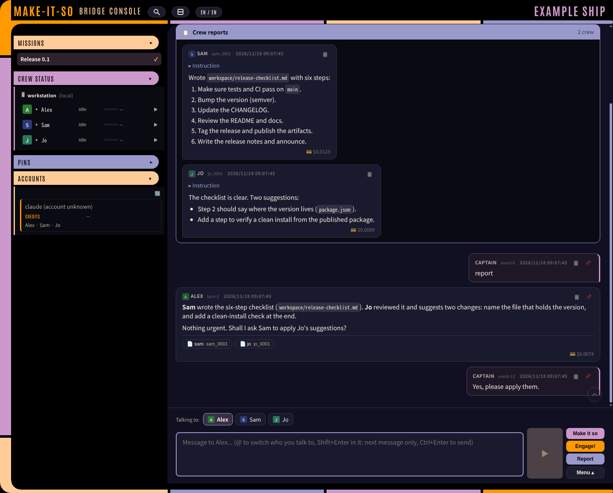
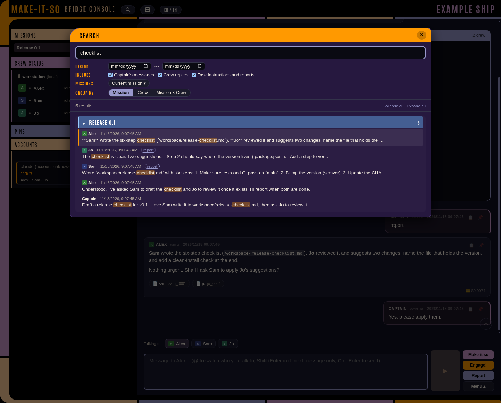

[English](README.md)

# make-it-so

AIエージェントたちを「クルー」として指揮する。ブラウザの会話画面から動かす、マルチエージェント開発ハーネスです。

AIは既にあなたの優秀なクルーでしょ？名前はついてる？

make-it-soはあなたが艦長になり、役職、名前を持ったクルーたちに指示を出したり助言を受けたりしながら、ミッションを成し遂げるためのシステムです。

> **アルファ版（v0.1）です。** 動作確認の範囲は限られており（[制約と動作確認の範囲](#制約と動作確認の範囲)を参照）、1.0 までは仕様や設定の形式が変わることがあります。
>
> **無保証（AS IS）で提供します。利用は自己責任でお願いします。** エージェントがあなたのマシン上でコマンドを実行するツールです。これを使って生じた損害（データの消失、費用の発生、情報の流出を含みます）について、作者は責任を負いません。使う前に、[安全上の注意](#安全上の注意)を読んでください。
>
> このプロジェクトは、某アメリカのTVドラマシリーズにインスパイアされた個人の作品です。某TVドラマシリーズの権利者や関連会社等とは全く無関係であり、公認・承認を受けたものではありません。某TVドラマシリーズは各権利者の商標です。クルーの名前・人数・役職は、設定ファイルで自由に変更できます（サンプルの設定は、特定の作品に由来しない名前を使っています）。



## 作者より

これは某TVドラマシリーズが好きな個人が、趣味で作っているツールです。
いつかあのデザインの画面をもった、自分が仕事に使えるアプリケーションを作りたいと思ってたんだけど、AIの力を借りてなんとか形にしました。
結構よく出来てると思うのでみんな使ってみて！

## 目次

- [作者より](#作者より)
- [特徴](#特徴)
- [仕組み](#仕組み)
- [クイックスタート](#クイックスタート)
- [設定](#設定)
- [安全上の注意](#安全上の注意)
- [制約と動作確認の範囲](#制約と動作確認の範囲)
- [ドキュメント](#ドキュメント)
- [開発・貢献](#開発貢献)
- [ライセンス](#ライセンス)

## 特徴

- **艦長口調の副作用。** 使っていると、話し方が自然に「艦長」になります。曖昧に頼むより、はっきり意図を伝える習慣がつきます。役割を意識すると仕事が捗る、という心理的な効果もありました。
- **指揮系統でエージェントを使い分ける。** 艦長（あなた）が副長に頼むと、副長が機関部長や少尉にタスクを委任し、結果を「report」で受け取って報告します。誰が何をできるかは、階級（`commander` / `chief` / `crew`）で決まります。
- **会話は「ミッション」ごとに分ける。** 課題ごとなどに、会話の箱を作れます。各ミッションの会話・タスク・PINは独立し、複数のミッションを並行して動かせます。
- **何が起きているかが見える。** クルーの状態（待機・作業中・起動中）、コンテキストの使用率、タスクの経過、未報告のタスク数を、左ペインに出します。
- **確認が必要な操作は、画面で承認する。** `permission_mode: default` のクルーがファイルを書き込もうとすると、チャット画面に承認の要求が出ます。複数のミッションで承認待ちが出ても、見逃さないよう目立たせます。
- **会話を検索できる。** 全文検索（語のAND）、期間、艦長の発言・返信・タスクの指示と報告での絞り込み、ミッション別／クルー別のまとめ方、ジャンプ。
- **使用量を、アカウントごとに見る。** 認証しているアカウント（Claude Code）ごとに、使用率とそのアカウントで動くクルーを出します。そのために、画面を開くたびに、`PATH` 上の `claude`（`claude auth status`・`claude --print /usage`）や `kiro-cli` を実行します（見つからなければ、使用量が「不明」になるだけです）。
- **別のPC・サーバのエージェントも使える。** SSH経由で、リモートホストのクルーを、ローカルと同じように扱えます。
- **よく使うメッセージやスキルを、手元に置ける。** 「そうしてくれ」「発進！」のボタンに加えて、入力欄の隣のカスタムメニューに、よく使うメッセージやスラッシュコマンドを登録できます。項目ごとに、すぐ送るか、入力欄に入れるだけかを選べ、艦ごとに設定します（設定アプリで、複数の艦で共有することもできます）。詳しくは、[カスタムメニューを使う](docs/guides/use-custom-menu.ja.md) を参照してください。
- **デスクトップアプリとして使える。** アプリを開くと、艦が1隻ならそれを動かし、複数なら一覧を出します。艦は専用のウィンドウで開き、画面用のポートはなく、ウィンドウを閉じると止まります。macOS でしか、作って試していません。署名もありません。[デスクトップアプリを使う](docs/guides/desktop-app.ja.md)を参照してください。
- **プロバイダーを選べる。** kiro-CLI と Claude Code（どちらも Agent Client Protocol 経由）。クルーごとに指定できます。
- **UIは日本語・英語。** UIの言語と、クルーが話す言語は、別々に切り替えられます。
- **すべてローカルに残る。** 会話の履歴は、艦ごとの SQLite に保存されます。

## 仕組み

```
艦長（あなた）── ブラウザ ──▶ make-it-so（Express + SQLite）
                                 │  ACP（標準入出力のJSON-RPC）
                  ┌──────────────┼──────────────┐
              副長 (commander)  機関部長 (chief)  少尉 (crew)   ※ 名前・人数・役職は自由
              kiro / claude      kiro / claude     kiro / claude  （リモートホストにも置ける）
                  └── タスクの委任・報告は、内蔵の「掲示板」（MCP）経由 ──┘
```

- **艦隊（fleet）** は、クルーの名簿（`roster.yml`）と、人格のファイル（`personnel/{ID}.md`）を持つ、艦から独立したディレクトリです。
- **艦（ship）** は、1つの運用単位です。`ship.yml` で、どのクルーがどの役職・階級を担い、どのディレクトリで作業するかを決めます。1つのプロセスが1つの艦を担当し、艦ごとに別のポート・別のDBになります。
- **クルー** は、kiro-CLI または Claude Code のプロセスです。人格は、既定では `personnel/{ID}.md` の内容を、起動時に注入します。`agent:` を指定すると、プロバイダー側の agent 定義（kiro の `.kiro/agents`、claude の `.claude/agents`）が人格になります。
- **階級** が、タスクに関する権限を決めます。コードは役職名を見ません（`first_officer` という名前も特別ではありません）。

| 階級 | できること |
|---|---|
| `commander` | タスクを発行でき、艦の**すべて**のタスクの報告を扱える（艦に1人まで）。艦長が最初に話しかける相手 |
| `chief` | タスクを発行でき、**自分が発行した**タスクの報告を扱える |
| `crew`（既定） | タスクを発行できない（作業を担当する） |

「全部委任する」「自分で作業する」といった振る舞いの個性は、コードではなく、人格ファイル（プロンプト）で決めます。

## クイックスタート

### 前提条件

- Node.js 22.13 以上（`.tool-versions` は 22.23.2）。`node:sqlite` を使うため、古い版は不可です。起動のたびに `ExperimentalWarning: SQLite is an experimental feature` と表示されますが、害はありません（Node 側の、実験的機能の表示です）。
- 使うエージェントのCLI（どちらか、または両方）。**インストールとログイン（認証）は、事前に済ませてください。**
  - kiro-cli（`kiro-cli` コマンドが PATH にあること）
  - Claude Code（`npx` で `@agentclientprotocol/claude-agent-acp` を起動します。初回はネットワークが要ります）
- `claude-agent-acp` の版は、`config.yml` の `acp.claude.args` で固定しています（既定は `0.106.0`）。アダプターの更新で挙動が変わりうるため、上げるときは動作を確認してから書き換えてください。

### インストールと起動

```bash
git clone https://github.com/eka-s/make-it-so.git
cd make-it-so
npm install
npm run init -- --provider claude   # または kiro。~/.make-it-so/ に、最小の設定（config.yml・名簿・艦）を作る
npm run build && npm start          # ビルドして起動する
```

起動すると、`Open http://127.0.0.1:3939 in your browser` と表示されます。そのURLをブラウザで開いてください。止めるときは、ターミナルで `Ctrl+C` を押します。

- `init` の代わりに、`npm run build && npm start -- --settings` で設定画面を開き、「プロジェクトから」で艦を作ることもできます（`~/.make-it-so/` が無くても使えます。指定したプロジェクトの `.claude` や `.kiro` から、クルーを作ります）。
- `init` は、ホームディレクトリの `~/.make-it-so/` に、`config.yml`、`roster.yml`（クルー1人）、`ships/{艦ID}/ship.yml` を作ります（`--ship` / `--port` で変更できます）。**既存のファイルは決して上書きしません**（1つでもあれば、何も書かずに止まります）。
- 使うエージェントのCLIが見つからないときは、`init` と起動時に案内を出します（ログイン済みかどうかは確認できません）。
- 開発するときは、`npm run build && npm start` の代わりに `npm run dev` で起動します（画面は Vite が配信し、URLは `http://localhost:{バックエンドのポート + 10000}` です。`127.0.0.1` では開けません）。開発用の依存（テストと lint の道具）には、既知の警告が残っており、`npm install` の最後に表示されることがありますが、配布物（本番の依存）には影響しません（`npm audit --omit=dev` は 0 件です）。
- 設定は、`npm start -- --settings` で開く設定画面（`http://127.0.0.1:3938`）でも見られます（`config.yml`・`hosts.yml`・名簿（人格とアイコンを含む）・艦の編集・起動・停止、全体の状態の表示のほか、既存のプロジェクト（`.claude` や `.kiro`）から艦を作ることもできます）。
- 艦が複数ある場合は、`--ship {艦ID}` を付けて起動します（例: `npm start -- --ship my-ship`、開発は `npm run dev -- --ship my-ship`）。

### はじめての会話

1. 画面下の「Talking to」で、話し相手を選びます（既定は、`commander` のクルー。いなければ、最初に定義したクルー）。
2. 入力欄に依頼を書いて、`Ctrl+Enter` で送ります。例: 「このプロジェクトの README を読んで、改善点を3つ挙げて」
3. クルーが複数いる艦では、`commander` や `chief` のクルーが、他のクルーにタスクを委任できます（例: 「v0.1 のリリースチェックリストを作って。書くのはSamに、レビューはJoに頼んで」。この例は、[`examples/fleet/`](examples/fleet/) のような複数人の艦向けです）。左ペインの「CREW STATUS」で、誰が作業中かが分かります。`npm run init` が作る艦は、クルー1人だけです。委任を試すには、設定画面で、クルーと役職を足してください。
4. 委任したタスクの結果を聞くには、入力欄の隣の「報告」を押します（または、`report` と送ります）。委任した側のクルーが、未報告のタスクの結果をまとめて報告します。
5. 入力欄の隣のボタンで、用意したメッセージをワンクリックで送れます。「そうしてくれ」（`make it so`）、「発進！」（`engage`）、「報告」（`report`）です。その下の「メニュー」ボタンは、自分で登録したメッセージとスラッシュコマンドの一覧を開きます（[カスタムメニューを使う](docs/guides/use-custom-menu.ja.md)）。
6. 話し相手は、入力欄で `@` を押すか、ボタンを押して切り替えます（Shift を押して選ぶと、次の1通だけの宛先になります）。

画面の主な操作:

| 操作 | 使い方 |
|---|---|
| ミッションの切り替え・作成 | 左ペインの「MISSIONS」 |
| 会話の検索 | ヘッダーの虫眼鏡、または `Ctrl+Shift+F` |
| 過去の発言を使い回す | 入力欄の最上行で `↑`（このミッションの直近20件から選ぶ。Enter かクリックで入力、Esc でやめる） |
| カスタムメニュー（よく使うメッセージとスラッシュコマンド） | 入力欄の隣の「メニュー」ボタン（一覧の末尾の「設定…」で、この艦の項目を編集） |
| テーマ・言語の切り替え | 左ペインの下の「設定」区画（テーマ、UI の言語、クルーの言語のラジオボタン）。デスクトップアプリでは、表示メニューでも |
| スラッシュコマンド | 入力欄の先頭で `/`（今の話し相手が実行できるものが候補に出ます） |
| クルーの人事記録 | 左ペインのクルーのアイコンをクリック（アイコン画像・モデルの変更、再起動、ペルソナの表示） |
| 発言のPIN | 発言の📌 |
| 応答の停止 | 処理中の発言にある「Stop generation」ボタン |



## 設定

設定は、ホームディレクトリの `~/.make-it-so/` にまとまっています。最小の例は、[`examples/fleet/`](examples/fleet/) にあります（`~/.make-it-so/` へコピーすれば、そのまま動きます）。

| ファイル | 内容 |
|---|---|
| `~/.make-it-so/config.yml`（任意） | 言語、プロバイダーの起動コマンド、ログ。雛形は [`config.sample.yml`](config.sample.yml) |
| `~/.make-it-so/roster.yml` | クルーの名簿（ID・表示名・プロバイダー・モデルなど）。人格は `~/.make-it-so/personnel/{ID}.md` |
| `~/.make-it-so/ships/{艦ID}/ship.yml` | 艦のポート・名前、どのクルーがどの役職・階級を担うか、ルール、作業ディレクトリ |

`ship.yml` の例:

```yaml
port: 3939
name: "My Ship"
crew:
  first_officer:          # 役職名（英数字・_・-。内容は、コードは見ない）
    member: alex          # roster.yml のID
    rank: commander
  chief_engineer:
    member: sam
    rank: chief
  ensign:
    member: jo
    permission_mode: default   # 確認が必要な操作は、画面で承認する
```

全フィールド、データの置き場所は、[設定リファレンス](docs/reference/configuration.ja.md) にまとめています。

### リモートホストのクルー（任意）

別PC・サーバ上のエージェントを使えます。リモートには、エージェント（kiro-cli / claude-agent-acp）と bash があればよく、make-it-so 専用の実行ファイルは不要です。

1. `~/.make-it-so/hosts.yml` に宛先を書きます（書けるのは `destination` だけです）。

   ```yaml
   hosts:
     dev-server:
       destination: dev-server   # ~/.ssh/config の Host 名、または user@host
   ```

2. 鍵・ポート・ユーザーなど接続の詳細は、各PCの `~/.ssh/config` に書きます（git で共有される設定に誤って残らないよう、`hosts.yml` には書けない作りにしてあります）。鍵認証で、パスワード入力なしに `ssh dev-server` できる必要があります。
3. `ship.yml` のクルーに、`host:` と、リモート側の絶対パスの `cwd:` を指定します。

   ```yaml
   chief_engineer:
     member: sam
     host: dev-server
     cwd: /srv/project
   ```

エージェントからメインの掲示板（MCP）への経路は、make-it-so がホストごとに張る SSH の逆トンネルで、自動的に確保されます。

## 安全上の注意

make-it-so は、AIエージェントにコマンドを実行させ、ファイルを書き込ませるツールです。便利な分、使う前に、次の点だけは読んでおいてください。

- **認証がありません。** サーバーは既定で `127.0.0.1`（このPCだけ）で待ち受けます。`config.yml` の `server.host` で `0.0.0.0` などに変えると、ネットワーク上の誰でも、クルーに指示を出せるようになります（クルーはファイルを書き込めます）。信頼できるネットワークの外へは、公開しないでください。
- **クルーは、既定では確認なしでコマンドを実行します。** claude の権限モードの既定（`auto`）では、`touch` のような状態を変えるコマンドも、承認を求められずに通ります。確認を求めたいクルーには、`ship.yml`（または `roster.yml`）で `permission_mode: default` を指定します。その場合、承認はチャット画面で行います。`default` でも、許可リストにあるツールは確認されません。
- **クルーは、あなたの権限で動きます。** エージェントはあなたのユーザーとして起動し、`cwd` の外のファイルにも届きえます。担当範囲（`targets`・`access`）は、プロンプトでの取り決めであり、**技術的なアクセス制御ではありません**。
- **リモートホストのクルーは、そのホストで動きます。** 逆トンネルにより、リモートホストの `127.0.0.1` から、メインの掲示板（`/mcp`。ポートは OS が選ぶ専用のリスナー）に届きます。届くのは、それだけで、艦の画面や API は届きません。掲示板には、起動のたびに作り、艦が起動したセッションだけに渡す、秘密の値が要りますが、そのホストを共有する他のユーザーが、それを読めれば、掲示板を呼べる点に注意してください。
- **会話の内容は、使うプロバイダー（kiro、Anthropic）に送られます。** 手元のDB（`{艦}/data/`）にも、すべて保存されます。

## 制約と動作確認の範囲

手元で確認できたのは、次の範囲です。**動作の保証はできません**（無保証については、ライセンスを参照）。画面は、デスクトップのブラウザ向けです（スマートフォンなどの狭い画面は、考慮していません）。

| 環境 | 状況 |
|---|---|
| Linux + claude（`claude-agent-acp@0.106.0`） | 開発に使っている環境。確認済み |
| リモートホスト（SSH。Dockerコンテナを見立てたLinux） | 確認済み |
| kiro-cli | 対応するコードはあるが、現在の版での動作は未確認（過去に v3.1.0 で確認）。設定画面の「プロジェクトから」の kiro 側（`.kiro` の読み取り）は、仕様に沿って作っただけで、実機では未確認 |
| macOS + claude（`claude-agent-acp@0.106.0`、Node 24.3.0） | 確認済み: ローカルのクルー（委任・報告・承認・検索）と、リモートのクルー（SSH 経由の Docker コンテナ）。下の異常終了時の確認は、macOS では行っていない |
| Windows | 未確認（動かない可能性が高い） |

- 異常終了時にエージェントのプロセスが残らないことは、Linux + claude（ローカルとリモートの両方）で確認しました（親を `kill -9` しても、作業中のコマンドごと終了します）。kiro-cli、macOS、Windows では未確認です。
- スラッシュコマンドは、claude でのみ確認しました。kiro は未確認です。クルーとまだ話していない間（セッションが無い間）は、候補は出ません。
- アカウントごとの使用率は、**ローカルで動く claude のクルーだけ**を識別できます（`claude auth status`）。kiro は「アカウント不明」の枠、リモートホストのクルーは「集計対象外」として出します。
- リモートのクルーには、`targets`（`access`）を指定できません。メイン側のローカルパスを案内する内容（workspace・Skill 一覧など）は出しません。接続が切れても、再接続して続きから再開はしません（次に呼びかけたとき、新しいセッションで立ち上がります）。リモートは、bash のある Unix 系のみです。
- **kiro-cli のツール呼び出しリーク（間欠バグ）:** kiro-cli 本体（v3.1.0 で確認）には、モデルが出したツール呼び出しが実行されないまま正常終了してしまう間欠バグがあります（本家 issue [`kirodotdev/Kiro#11771`](https://github.com/kirodotdev/Kiro/issues/11771) ほか）。エラーも承認プロンプトも出ないため、「静かに止まった」ように見えます。自動回復は期待できないので、頻発するクルーは、セッションを再起動してください（人事記録のポップアップから行えます）。

## ドキュメント

| ドキュメント | 内容 |
|---|---|
| [`docs/`](docs/README.ja.md) | 基本概念、ガイド、リファレンス（設定・HTTP API・データモデル・画面の挙動）、セキュリティ、アーキテクチャ |
| [`CHANGELOG.md`](CHANGELOG.md) | 変更履歴 |
| [`CLAUDE.md`](CLAUDE.md) | このリポジトリで開発する際の、アーキテクチャ・コードの構成・テストの方針 |

## 開発・貢献

さあ、開発を始めよう。発進！

```bash
npm run dev         # 開発用に起動（サーバー + Vite）
npm run build       # ビルド（サーバー: tsc、クライアント: Vite）
npm run typecheck   # 型チェック（サーバー・クライアント）
npm run lint        # eslint
npm test            # テスト（vitest。艦の指定は不要）
```

コードの構成（`config.ts` を直接 import するのは配線層の `index.ts` だけで、他のモジュールは必要な値を引数で受け取る、など）とテストの方針は、[アーキテクチャ](docs/architecture.ja.md) と [`CLAUDE.md`](CLAUDE.md) を参照してください。

不具合の報告・質問は、GitHub の Issue へお願いします。個人で開発しているアルファ版のため、対応をお約束することはできません。プルリクエストは歓迎ですが、仕様や設定の形式を変える変更は、先に Issue で相談してください。

## ライセンス

[MIT License](LICENSE)。ソフトウェアは「現状のまま（AS IS）」で提供され、明示・黙示を問わず、いかなる保証もありません。利用は自己責任でお願いします（条文は LICENSE を参照）。
