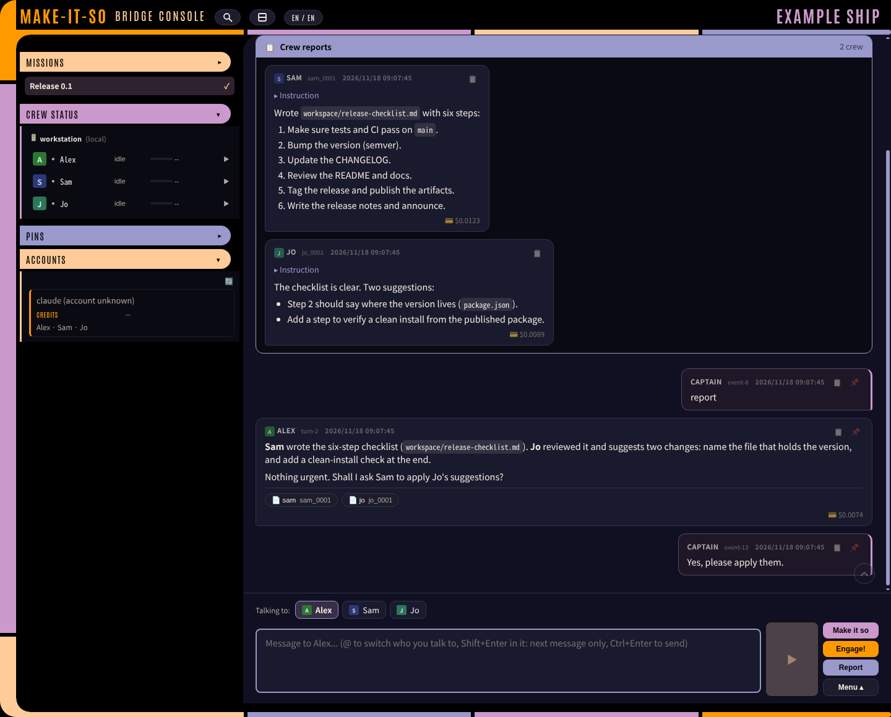
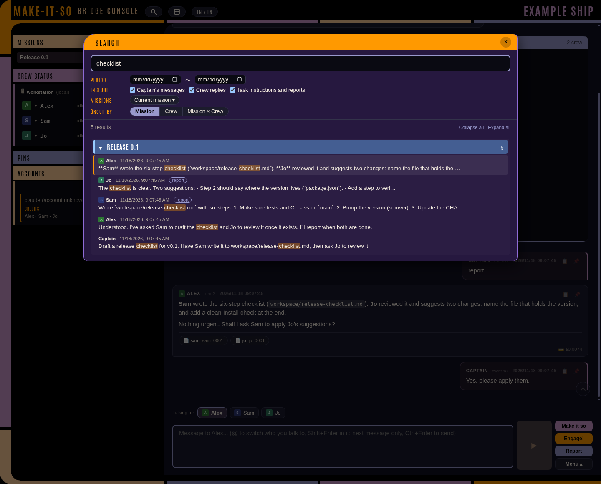

[日本語](README.ja.md)

# make-it-so

Command your AI agents as a "crew". A multi-agent development harness that you run from a chat screen in your browser.

The AI is already your capable crew, right? Have you given them names yet?

make-it-so makes you the captain. You give orders to crew members who each have a role and a name, take their advice, and see your mission through.

> **This is an alpha release (v0.1).** What has been verified is limited (see [Limitations and tested scope](#limitations-and-tested-scope)), and specs and configuration formats may change until 1.0.
>
> **Provided AS IS, with no warranty. Use it at your own risk.** This tool lets agents run commands on your machine. The author takes no responsibility for any damage arising from its use (including data loss, costs incurred, and leaked information). Before using it, read the [Safety notes](#safety-notes).
>
> This project is a personal work inspired by a certain American TV drama series. It has no connection whatsoever with the rights holders or affiliates of that series, and is neither authorized nor endorsed by them. That series is a trademark of its respective rights holders. The names, number, and roles of the crew can be changed freely in the configuration files (the sample configuration uses names that do not come from any particular work).



## From the author

This is a tool made as a hobby by an individual who loves a certain TV drama series.
I had always wanted to build an application with that look and feel on screen, one I could actually use for work, and with some help from AI I finally got it into shape.
I think it turned out pretty well, so everyone, give it a try!

## Contents

- [From the author](#from-the-author)
- [Features](#features)
- [How it works](#how-it-works)
- [Quick start](#quick-start)
- [Configuration](#configuration)
- [Safety notes](#safety-notes)
- [Limitations and tested scope](#limitations-and-tested-scope)
- [Documentation](#documentation)
- [Development and contributing](#development-and-contributing)
- [License](#license)

## Features

- **Captain's-voice side effect.** The more you use it, the more naturally you start talking like a "captain". You pick up the habit of stating your intent clearly instead of asking vaguely. Being conscious of roles also turned out to make the work go more smoothly.
- **Use agents through a chain of command.** When the captain (you) asks the commander, the commander delegates tasks to the chief engineer and ensigns, collects the results with "report", and reports back. Who can do what is determined by rank (`commander` / `chief` / `crew`).
- **Conversations are split by "mission".** You can create a separate container for the conversation per issue, for example. Each mission's conversation, tasks, and pins are independent, and you can run several missions in parallel.
- **You can see what is going on.** The left pane shows each crew member's state (idle, working, starting), context usage, task progress, and the number of unreported tasks.
- **Operations that need confirmation are approved on screen.** When a crew member with `permission_mode: default` tries to write a file, a permission request appears in the chat screen. Even when several missions have pending permissions, they are highlighted so you don't miss them.
- **You can search conversations.** Full-text search (AND of words), date range, filtering by the captain's messages, replies, and task instructions and reports, grouping by mission or by crew member, and jumping to a result.
- **See usage per account.** For each authenticated account (Claude Code), it shows the usage rate and the crew members running on that account. To do this, every time you open the screen it runs `claude` on your `PATH` (`claude auth status`, `claude --print /usage`) and `kiro-cli` (if they are not found, usage simply shows as "unknown").
- **Agents on other PCs and servers work too.** Over SSH, you can handle crew members on a remote host just like local ones.
- **Keep your favorite messages and skills at hand.** Besides the "Make it so" and "Engage!" buttons, a custom menu next to the input box holds the messages and slash commands you use often. Each item is sent at once or only put in the input box, and the items are set up per ship (or shared by several ships in the settings screen). See [Use the custom menu](docs/guides/use-custom-menu.md).
- **Choose your provider.** kiro-CLI and Claude Code (both via the Agent Client Protocol). It can be specified per crew member.
- **The UI is in Japanese and English.** The UI language and the language the crew speaks can be switched separately.
- **Everything stays local.** Conversation history is stored in a per-ship SQLite database.

## How it works

```
Captain (you) ── browser ──▶ make-it-so (Express + SQLite)
                                 │  ACP (JSON-RPC over stdio)
                  ┌──────────────┼──────────────┐
          Commander (commander)  Chief engineer (chief)  Ensign (crew)   * names, number, and roles are up to you
              kiro / claude          kiro / claude        kiro / claude   (can also be placed on remote hosts)
                  └── Task delegation and reports go through the built-in "MCP board" ──┘
```

- A **fleet** is a directory, independent of any ship, that holds the crew roster (`roster.yml`) and the persona files (`personnel/{ID}.md`).
- A **ship** is one operational unit. `ship.yml` decides which crew member holds which role and rank, and which directory they work in. One process handles one ship, and each ship gets its own port and its own DB.
- A **crew member** is a kiro-CLI or Claude Code process. By default, the persona is the content of `personnel/{ID}.md`, injected at startup. If you specify `agent:`, the provider-side agent definition (kiro's `.kiro/agents`, claude's `.claude/agents`) becomes the persona.
- **Rank** determines authority over tasks. The code does not look at role names (the name `first_officer` is not special either).

| Rank | What it can do |
|---|---|
| `commander` | Can issue tasks and handle reports for **all** tasks on the ship (at most one per ship). The first person the captain talks to |
| `chief` | Can issue tasks and handle reports for the tasks **it issued itself** |
| `crew` (default) | Cannot issue tasks (does the work) |

Behavioral personality, such as "delegate everything" or "do the work yourself", is decided not by the code but by the persona file (the prompt).

## Quick start

### Prerequisites

- Node.js 22.13 or later (`.tool-versions` says 22.23.2). It uses `node:sqlite`, so older versions will not work. Every launch prints `ExperimentalWarning: SQLite is an experimental feature`, which is harmless (it is Node's notice about an experimental feature).
- The CLI of the agent you want to use (either one, or both). **Install it and log in (authenticate) beforehand.**
  - kiro-cli (the `kiro-cli` command must be on your PATH)
  - Claude Code (launches `@agentclientprotocol/claude-agent-acp` via `npx`. The first run needs network access)
- The version of `claude-agent-acp` is pinned by `acp.claude.args` in `config.yml` (default `0.106.0`). Adapter updates can change behavior, so when you bump it, check that everything still works before rewriting it.

### Install and launch

```bash
git clone https://github.com/eka-s/make-it-so.git
cd make-it-so
npm install
npm run init -- --provider claude   # or kiro. Creates a minimal setup (config.yml, roster, ship) in ~/.make-it-so/
npm run build && npm start          # build and launch
```

On launch it prints `Open http://127.0.0.1:3939 in your browser`. Open that URL in your browser. To stop, press `Ctrl+C` in the terminal.

- Instead of `init`, you can run `npm run build && npm start -- --settings` to open the settings screen and create a ship with "From a project" (this works even without `~/.make-it-so/`. It creates crew members from the `.claude` or `.kiro` of the project you specify).
- `init` creates `config.yml`, `roster.yml` (one crew member), and `ships/{shipID}/ship.yml` in `~/.make-it-so/` in your home directory (the ship ID and port can be changed with `--ship` / `--port`). **It never overwrites existing files** (if even one exists, it stops without writing anything).
- If the CLI of the agent you want to use is not found, `init` and startup print guidance (it cannot check whether you are logged in).
- When developing, launch with `npm run dev` instead of `npm run build && npm start` (the screen is served by Vite, and the URL is `http://localhost:{backend port + 10000}`. It cannot be opened at `127.0.0.1`). The development dependencies (testing and lint tools) still carry known warnings, which may be shown at the end of `npm install`, but they do not affect the distributed package (the production dependencies; `npm audit --omit=dev` reports 0 findings).
- Settings can also be viewed in the settings screen (`http://127.0.0.1:3938`) opened with `npm start -- --settings` (you can edit `config.yml`, `hosts.yml`, the roster (including personas and icons), and ships, start and stop them, and see the overall status, and you can also create a ship from an existing project (`.claude` or `.kiro`)).
- If you have more than one ship, launch with `--ship {shipID}` (for example `npm start -- --ship my-ship`, or `npm run dev -- --ship my-ship` for development).

### Your first conversation

1. Choose who to talk to with "Talking to" at the bottom of the screen (the default is the `commander` crew member; if there is none, the first one defined).
2. Write your request in the input box and send it with `Ctrl+Enter`. Example: "Read this project's README and list three improvements"
3. On a ship with several crew members, a `commander` or `chief` crew member can delegate tasks to the others (for example: "Make a release checklist for v0.1. Ask Sam to write it and Jo to review it". This example is meant for a multi-member ship such as [`examples/fleet/`](examples/fleet/)). "CREW STATUS" in the left pane shows who is working. The ship that `npm run init` creates has only one crew member. To try delegation, add crew members and roles in the settings screen.
4. To hear the results of delegated tasks, press "Report" beside the input box (or send `report`). The delegating crew member summarizes the results of the unreported tasks and reports them.
5. The buttons beside the input box send a prepared message with one click: "Make it so" (`make it so`), "Engage!" (`engage`), and "Report" (`report`). The "Menu" button below them opens your own list of messages and slash commands ([Use the custom menu](docs/guides/use-custom-menu.md)).
6. Switch who you are talking to by pressing `@` in the input box, or with the button (pressing Shift while choosing makes it the recipient of the next single message only).

Main operations on the screen:

| Operation | How |
|---|---|
| Switch or create missions | "MISSIONS" in the left pane |
| Search conversations | The magnifier in the header, or `Ctrl+Shift+F` |
| Reuse an earlier message | `↑` on the first row of the input box (pick from your last 20 messages in the mission; Enter or click to use, Esc to cancel) |
| Custom menu (your favorite messages and slash commands) | The "Menu" button beside the input box ("Settings…" at the bottom of the list edits it for this ship) |
| Switch the language | The language label in the header, such as `EN / 日本語` (the UI language, then the crew language; click to change) |
| Slash commands | `/` at the start of the input box (the commands the current conversation target can run appear as candidates) |
| A crew member's personnel record | Click a crew member's icon in the left pane (change the icon image or model, restart, view the persona) |
| Pin a message | 📌 on the message |
| Stop a response | The "Stop generation" button on a message being processed |



## Configuration

All configuration lives in `~/.make-it-so/` in your home directory. A minimal example is in [`examples/fleet/`](examples/fleet/) (copy it to `~/.make-it-so/` and it works as is).

| File | Contents |
|---|---|
| `~/.make-it-so/config.yml` (optional) | Language, provider launch commands, logging. The template is [`config.sample.yml`](config.sample.yml) |
| `~/.make-it-so/roster.yml` | The crew roster (ID, display name, provider, model, and so on). Personas are `~/.make-it-so/personnel/{ID}.md` |
| `~/.make-it-so/ships/{shipID}/ship.yml` | The ship's port and name, which crew member holds which role and rank, rules, and working directories |

An example `ship.yml`:

```yaml
port: 3939
name: "My Ship"
crew:
  first_officer:          # role name (alphanumerics, _ and -. The code does not look at its content)
    member: alex          # ID in roster.yml
    rank: commander
  chief_engineer:
    member: sam
    rank: chief
  ensign:
    member: jo
    permission_mode: default   # operations that need confirmation are approved on screen
```

All fields and where data is stored are covered in the [configuration reference](docs/reference/configuration.md).

### Crew on remote hosts (optional)

You can use agents on other PCs and servers. The remote side only needs the agent (kiro-cli / claude-agent-acp) and bash; no make-it-so-specific executable is required.

1. Write the destination in `~/.make-it-so/hosts.yml` (`destination` is the only thing you can write).

   ```yaml
   hosts:
     dev-server:
       destination: dev-server   # a Host name in ~/.ssh/config, or user@host
   ```

2. Write connection details such as keys, ports, and users in each PC's `~/.ssh/config` (`hosts.yml` is deliberately built so that you cannot write them there, so they don't end up by mistake in configuration shared through git). You must be able to run `ssh dev-server` with key authentication, without typing a password.
3. For the crew member in `ship.yml`, specify `host:` and `cwd:` (an absolute path on the remote side).

   ```yaml
   chief_engineer:
     member: sam
     host: dev-server
     cwd: /srv/project
   ```

The route from the agent to the main MCP board is secured automatically by an SSH reverse tunnel that make-it-so sets up for each host.

## Safety notes

make-it-so is a tool that lets AI agents run commands and write files. As convenient as that is, please read the following points before you use it.

- **There is no authentication.** By default the server listens on `127.0.0.1` (this PC only). If you change `server.host` in `config.yml` to something like `0.0.0.0`, anyone on the network can give orders to your crew (and crew members can write files). Do not expose it outside a trusted network.
- **By default, crew members run commands without asking.** In claude's default permission mode (`auto`), even state-changing commands such as `touch` go through without asking for approval. For crew members that should ask before acting, specify `permission_mode: default` in `ship.yml` (or `roster.yml`). In that case, you answer the permission request in the chat screen. Even with `default`, tools on the allowlist do not ask for confirmation.
- **Crew members run with your privileges.** Agents are launched as your user and can reach files outside `cwd`. The areas of responsibility (`targets`, `access`) are agreements made through the prompt, and are **not technical access control**.
- **Crew on remote hosts run on that host.** Through the reverse tunnel, the main MCP board (`/mcp`) can be reached from the remote host's `127.0.0.1`. Note that other users who share that host can call the board.
- **The content of conversations is sent to the provider you use (kiro, Anthropic).** It is also all stored in the local DB (`{ship}/data/`).

## Limitations and tested scope

This is the range we were able to verify locally. **We cannot guarantee that it works** (for the lack of warranty, see the license). The screen is designed for desktop browsers (narrow screens such as smartphones are not taken into account).

| Environment | Status |
|---|---|
| Linux + claude (`claude-agent-acp@0.106.0`) | The environment used for development. Verified |
| Remote host (SSH. a Docker container standing in for a remote Linux machine) | Verified |
| kiro-cli | The code for it exists, but operation with the current version is unverified (verified with v3.1.0 in the past). The kiro side of "From a project" in the settings screen (reading `.kiro`) was only built to the spec and has not been verified on a real machine |
| macOS | Unverified |
| Windows | Unverified (likely does not work) |

- We verified on Linux + claude (both local and remote) that no agent processes are left behind after an abnormal exit: even if you `kill -9` the parent, the agents exit along with any commands in progress. This is unverified with kiro-cli and on Windows.
- Slash commands were verified only with claude. kiro is unverified. While you have not yet talked to the crew member (while there is no session), no candidates appear.
- Per-account usage can identify **only locally running claude crew members** (`claude auth status`). kiro is shown in an "account unknown" slot, and crew on remote hosts as "Not tracked".
- For remote crew members, `targets` (`access`) cannot be specified. Content that points to local paths on the main side (workspace, Skill list, and so on) is not given to them. If the connection drops, it does not reconnect and resume where it left off (the next time you call out to them, they start up in a new session). Remote hosts are limited to Unix-like systems with bash.
- **kiro-cli tool-call leak (intermittent bug):** kiro-cli itself (verified with v3.1.0) has an intermittent bug where the turn ends normally even though a tool call issued by the model was never executed (the upstream issue [`kirodotdev/Kiro#11771`](https://github.com/kirodotdev/Kiro/issues/11771) and others). There is neither an error nor an approval prompt, so it looks like it "quietly stopped". Do not expect automatic recovery; for a crew member where this happens often, restart the session (you can do this from the personnel record popup).

## Documentation

| Document | Contents |
|---|---|
| [`docs/`](docs/) | Basic concepts, guides, references (configuration, HTTP API, data model, screen behavior), security, architecture |
| [`CHANGELOG.md`](CHANGELOG.md) | Change history |
| [`CLAUDE.md`](CLAUDE.md) | Architecture, code organization, and testing policy for developing in this repository |

## Development and contributing

Now, let's start developing. Engage!

```bash
npm run dev         # launch for development (server + Vite)
npm run build       # build (server: tsc, client: Vite)
npm run typecheck   # type check (server and client)
npm run lint        # eslint
npm test            # tests (vitest. No need to specify a ship)
```

For the code organization (only the wiring layer `index.ts` imports `config.ts` directly, and every other module receives the values it needs as arguments, and so on) and the testing policy, see [Architecture](docs/architecture.md) and [`CLAUDE.md`](CLAUDE.md).

Please report bugs and ask questions through GitHub Issues. This is an alpha developed by an individual, so we cannot promise a response. Pull requests are welcome, but for changes that alter specs or configuration formats, please discuss them in an Issue first.

## License

[MIT License](LICENSE). The software is provided "AS IS", without warranty of any kind, express or implied. Use it at your own risk (see LICENSE for the full text).
