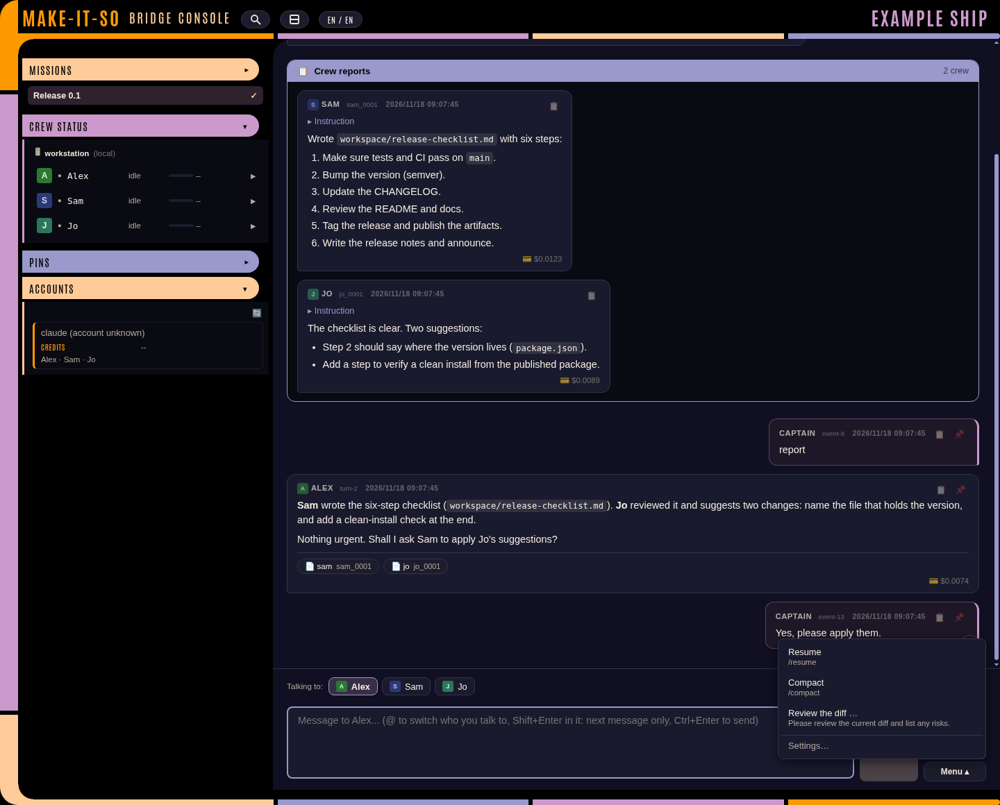

[English](use-custom-menu.md)

# カスタムメニューを使う

入力欄の隣の「メニュー」ボタンに、よく使うメッセージやスラッシュコマンドを登録しておくと、ワンクリックで実行できます。

## 項目を実行する

1. 「メニュー」（入力欄の隣の4つのボタンの、いちばん下）をクリックします。
2. 項目をクリックします。
   - **すぐ送信**の項目は、今の宛先へ、そのまま送られます。
   - 「…」が付いた項目は、**入力欄に入るだけ**です。必要なら本文を直して、いつもどおり送信（`Ctrl+Enter`）します。

作ったばかりの艦隊では、どの艦にも、`Resume`（`/resume`）と `Compact`（`/compact`）の2つがあります。

## この艦のメニューを編集する

1. メニューを開き、いちばん下の「設定…」をクリックします。
2. 項目を追加・変更します。項目には、次の欄があります。

| 欄 | 意味 |
|---|---|
| 名前 | メニューに出す名前 |
| 種類 | 「メッセージ」は、本文をメッセージとして送ります。「スラッシュコマンド」は、スラッシュコマンドを実行します（`/` で始まる1行。`/` を省くと補います） |
| クリックしたとき | 「すぐ送信」か、「入力欄に入れるだけ」 |
| コマンド | 送る文字列 |

3. ▲ ▼ で並べ替え、「削除」で項目を消し、「保存」で確定します。

ここでの変更は、**この艦だけ**に効きます。新しい項目も、この艦だけで有効です。

- 他の艦も使っている項目には、その旨の注意が出ます。変更すると、他の艦にも反映されます。
- そうした項目の「削除」は、この艦から外すだけです。他の艦には残ります。「すべての艦」で有効だった項目は、この艦だけが切れ、あとから作る艦には付きます。
- メニューの各項目には、名前の下に、送る本文が出ます。すぐ送信する項目は、クリックする前に、本文を確かめてください。

## 複数の艦で共有する

設定アプリ（`npm start -- --settings`、`http://127.0.0.1:3938`）の「カスタムメニュー」タブを開きます。すべての項目と、項目ごとに有効にする艦が並びます。「すべての艦」（あとから作る艦を含む）にチェックするか、艦を1つずつ選び、保存します。艦を1つも選ばない項目は、保存されますが、どの艦にも出ません。「すべての艦」にチェックしたときも、艦が並びます。チェックを外した艦では、その項目が切れます。

## 保存先

項目は、艦隊の1つのファイル、[`~/.make-it-so/quick-actions.yml`](../reference/configuration.ja.md#quick-actionsyml) にあります。手で編集することもできます。艦は、メニューを開くたびにこれを読むので、再起動は要りません。
