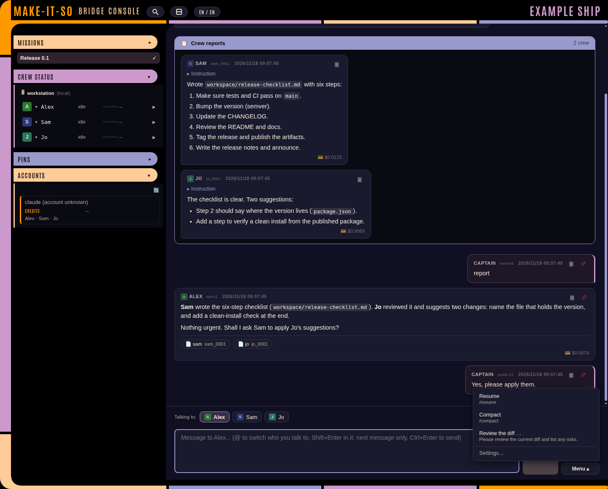

[日本語](use-custom-menu.ja.md)

# Use the Custom Menu

The "Menu" button beside the input box keeps the messages and slash commands you use often, so you can run them with one click.

## Run an item

1. Click "Menu" (the last of the four buttons beside the input box).
2. Click an item.
   - An item that **sends at once** is sent to the current target right away.
   - An item marked with "…" **only fills the input box**. Edit the text if you like, then send it as usual (`Ctrl+Enter`).

A new fleet starts with two items on every ship: `Resume` (`/resume`) and `Compact` (`/compact`).

## Edit this ship's menu

1. Open the menu and click "Settings…" at the bottom.
2. Add and change items. Each item has:

| Field | Meaning |
|---|---|
| Name | The label in the menu |
| Kind | "Message" sends the text as a message. "Slash command" runs a slash command (one line starting with `/`; the `/` is added if you leave it out) |
| On click | "Send at once", or "Put in the message box only" |
| Command | The text to send |

3. Use ▲ ▼ to reorder, "Remove" to remove an item, and "Save" to keep the changes.

What you change here applies to **this ship only**. A new item is enabled on this ship only.

- An item that other ships use too shows a note. Changing it changes it for them as well.
- "Remove" on such an item only takes it off this ship; the other ships keep it. An item that was enabled on "All ships" is switched off for this ship only, and ships made later still get it.
- Each item in the menu shows the text it sends under its name, so check it before you click an item that sends at once.

## Share items across ships

Open the settings screen (`npm start -- --settings`, `http://127.0.0.1:3938`) and go to the "Custom menu" tab. It lists every item and, for each, the ships it is enabled on: tick "All ships" (new ships included) or choose ships one by one. Save to apply. An item with no ship ticked is kept but shows on no ship. With "All ships" ticked, the ships are listed too: untick one to switch the item off there.

## Where it is stored

The items live in one fleet file, [`~/.make-it-so/quick-actions.yml`](../reference/configuration.md#quick-actionsyml), so you can also edit it by hand. A ship reads it each time the menu is opened, so no restart is needed.
